 

**Bilgi İşlem · Ağ & Altyapı · Yazılım · Oyun Geliştirme**

## Hakkımda

İstanbul Nişantaşı Üniversitesi'nde **Bilgi İşlem Uzman Yardımcısı** olarak çalışıyorum. Günlük işimde kampüs altyapısı, ağ cihazları, Windows uç noktaları, donanım arızaları ve son kullanıcı desteğiyle ilgileniyorum. Boş zamanlarımda faydalı masaüstü araçları, web uygulamaları ve oyunlar geliştiriyorum.

`150 WPM` · `%99 doğruluk` · `10FastFingers Türkiye Top 10`

## Uzmanlık alanlarım

| Altyapı & ağ | Sistem & destek | Geliştirme |
| :--- | :--- | :--- |
| TCP/IP, switching, VLAN, ağ teşhisi | Windows, Active Directory, Hyper-V, PowerShell, donanım | Rust, Tauri, JavaScript, HTML/CSS, Unity |

## Projeler

> **Not:** Bazı proje kaynak kodları şu anda özel GitHub depolarında tutuluyor. Ziyaretçiler proje bağlantılarını yalnızca erişim izinleri varsa açabilir.

| Proje | Açıklama |
| :--- | :--- |
| **[HyDesk](https://github.com/taneryigitxl/HyDesk)** | Rust + Tauri ile geliştirilen Windows uzak masaüstü uygulaması |
| **[Flyworm](https://github.com/taneryigitxl/flyworm)** | Windows optimizasyon ve debloat aracı |
| **[Tondy PC Doctor](https://github.com/taneryigitxl/tondy-pc-doctor)** | Windows tanılama ve sorun giderme uygulaması |
| **[Nita Yollarda](https://yigittaner.online/)** | Web tabanlı interaktif oyun |
| **[yigittaner.com](https://www.yigittaner.com/)** | Kişisel portfolyo, projeler ve özgeçmiş |

## Kullandığım araçlar

## Deneyim & eğitim

**Bilgi İşlem Uzman Yardımcısı** · İstanbul Nişantaşı Üniversitesi · 2026 — devam ediyor

**Bilişim Güvenliği Teknolojisi** · İstanbul Kent Üniversitesi · 2024–2026

**Sadabad Anadolu Lisesi** · 2019–2023

### Eğitimler & sertifikalar

Google AI Essentials · BTK Akademi: Bilgi Teknolojilerine Giriş, İşletim Sistemlerine Giriş, Cisco Ağ Temelleri, İleri Ağ Teknolojileri

## GitHub etkinliği

---

*Build useful things. Keep systems reliable.*

[Web sitesi](https://www.yigittaner.com/) · [LinkedIn](https://www.linkedin.com/in/taneryigit/) · [E-posta](mailto:taneryigit.it@gmail.com)

